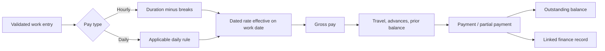
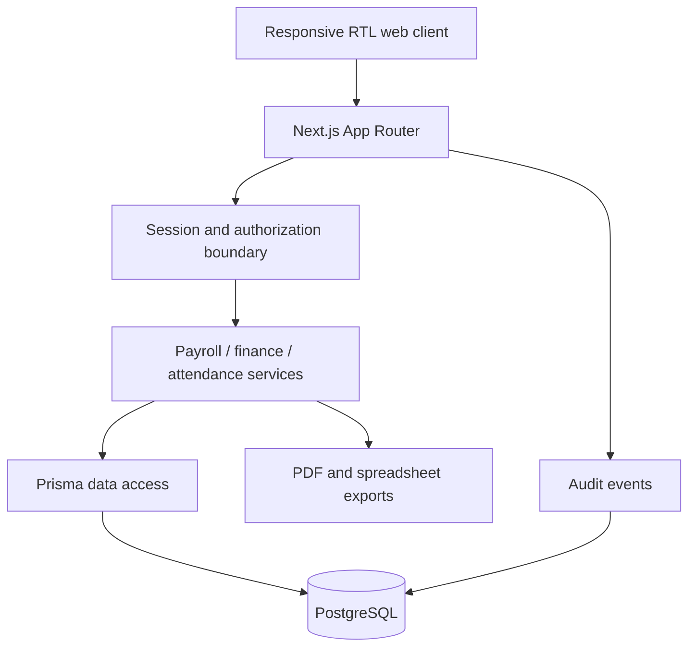
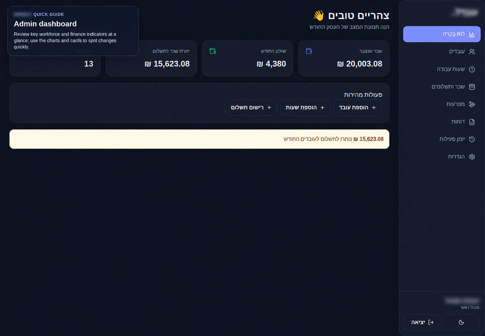
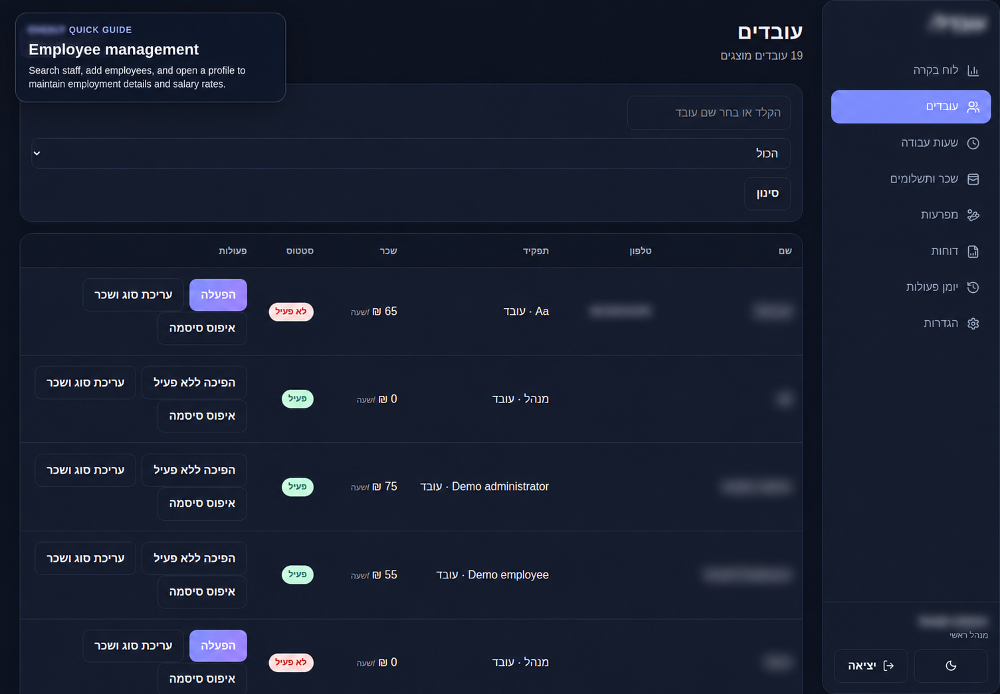
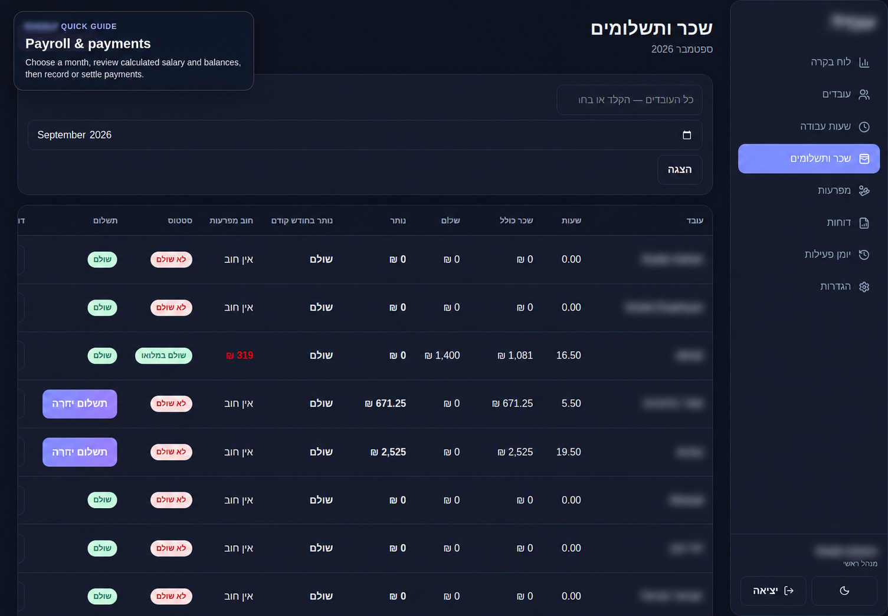
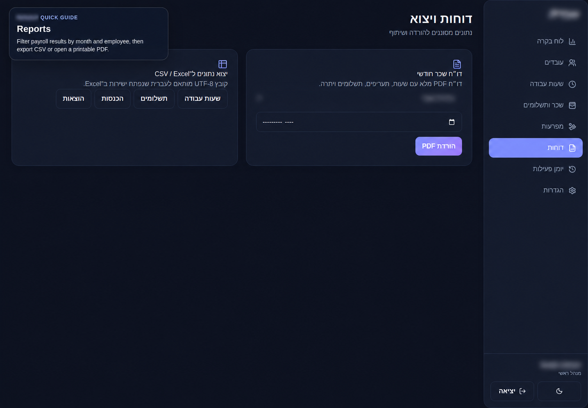
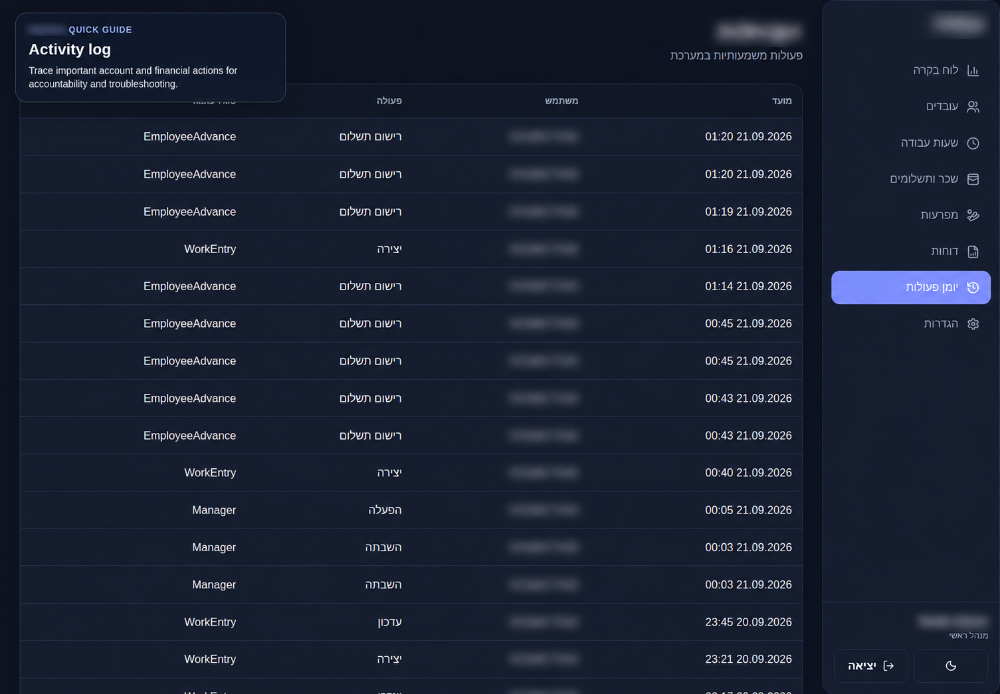
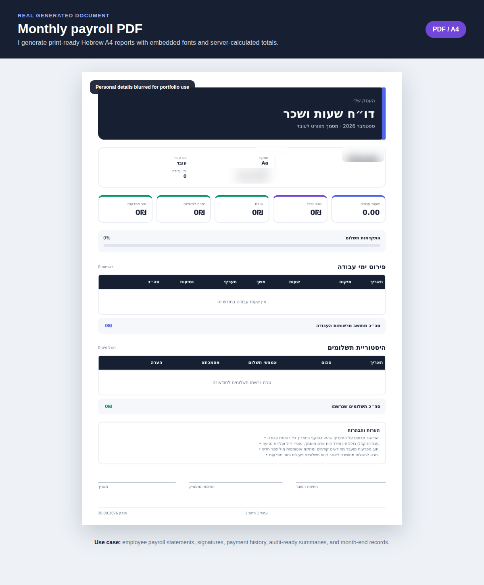

# Workforce Management Platform

Production-oriented workforce, attendance and payroll management platform.

   

## Overview

This full-stack application supports employee administration, attendance, historical pay rates, payroll settlement, advances, finance records, reporting, and auditability through a Hebrew-first RTL interface. It was built for a real customer; the customer identity and production data are intentionally excluded.

## Business Problem

Workforce and payroll records are often divided among spreadsheets, messages, and manual calculations. Historical rate changes, overnight work, partial payments, advances, contractor rules, and month-end reporting make that approach difficult to reconcile and audit.

## Solution

The platform centralizes employee and financial operations while keeping payroll calculations authoritative on the server. Dated pay rates preserve historical accuracy, money uses fixed-precision database fields, and reversals preserve financial history instead of deleting it.

## Roles

| Role | Scope |
|---|---|
| Administrator | Employees, work records, payroll, finance, reports, settings, and audit events |
| Manager | Authorized operational management with server-enforced role checks |
| Employee | Restricted self-service access to the employee's own hours, payroll, and reports |

## Features

- Employee lifecycle, employment types, private administrative notes, and dated pay rates
- Automatic or manual work entries, overnight shifts, breaks, locations, templates, and batch shift actions
- Hourly and daily pay, contractor rules, travel allowances, advances, partial payments, and outstanding balances
- Payroll periods, month locking, reversals, linked finance entries, and settlement
- Income/expense records, categories, cash-flow reporting, PDF payroll documents, and spreadsheet-compatible exports
- Database-backed sessions, role-based access, audit logs, and employee portal

## Payroll Logic

Calculations run on the server. Decimal arithmetic and PostgreSQL fixed-precision columns avoid binary floating-point handling for money.

## Architecture

## Technology Stack

Next.js 16, React 19, TypeScript, PostgreSQL, Prisma, Zod, bcrypt, JOSE, Tailwind CSS, Recharts, ExcelJS, React PDF, Vitest, Docker Compose, and Nginx.

## Authentication & Security

Sessions are database-backed; random tokens are stored as hashes. Passwords are adaptively hashed. Authorization is enforced on server routes, including employee ownership checks. State-changing requests receive origin/CSRF controls, rate limits protect sensitive paths, and production cookies use secure attributes. Details are summarized in [Security](docs/SECURITY.md).

## Screenshots

All views below use anonymized or demo data. Identifying fields are blurred.

| Dashboard | Employees |
|---|---|
|  |  |

| Payroll | Reports |
|---|---|
|  |  |

| Audit | Generated payroll PDF |
|---|---|
|  |  |

## Engineering Challenges

- Applying the rate effective on each work date while preserving later rate changes
- Correctly handling overnight shifts and hourly/daily/contractor pay paths
- Keeping partial payments, advances, reversals, payroll balances, and finance entries reconcilable
- Generating print-ready Hebrew/RTL PDF reports with embedded fonts
- Enforcing employee self-service boundaries at the server rather than relying on hidden UI

## Data Model Overview

Employees own dated pay rates, work entries, advances, and payments. Payroll periods provide month-level state. Payments can link to finance records; reversals preserve their audit trail. Users, sessions, settings, categories, and audit events support platform operations.

## About This Repository

This is a portfolio showcase repository. The production source code is maintained privately. The customer identity and production data are intentionally excluded. Screenshots show sanitized demonstration records, not customer data.

