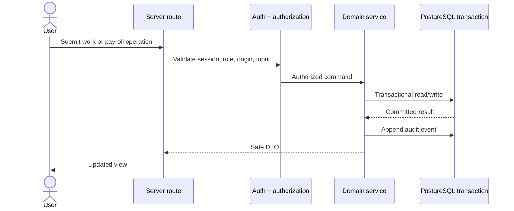

# Architecture

The Next.js application owns both the rendered interface and server route boundary. Route handlers authenticate the session, apply role and ownership rules, validate input, and call focused payroll, finance, attendance, and reporting services. Prisma maps those services to PostgreSQL.

PostgreSQL is not exposed publicly in the documented deployment shape. Migrations run as a separate one-shot operation before the application is updated. Nginx provides the public reverse-proxy boundary.

